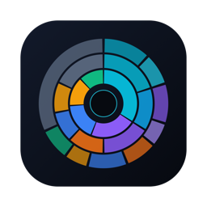
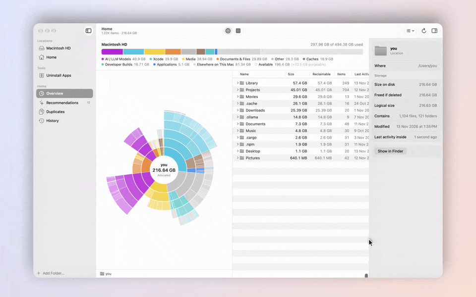
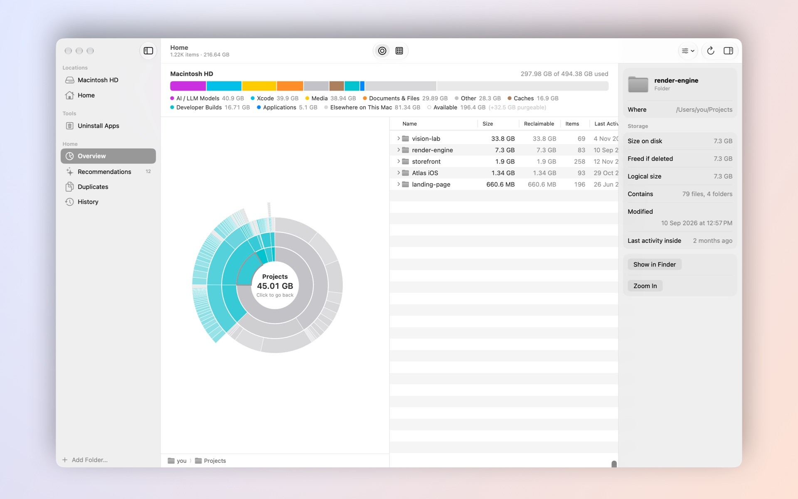
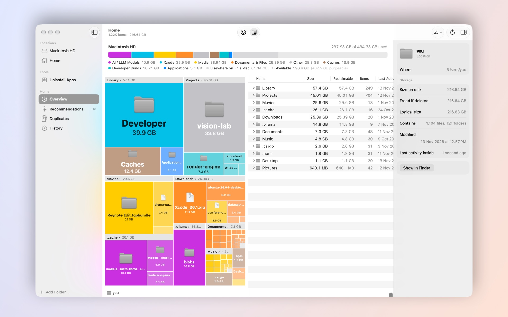
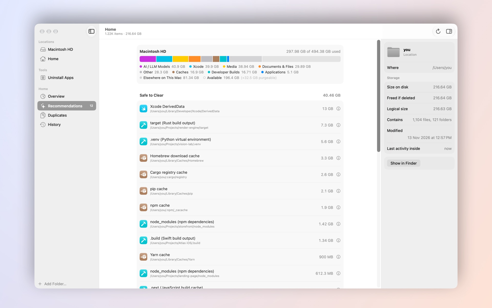
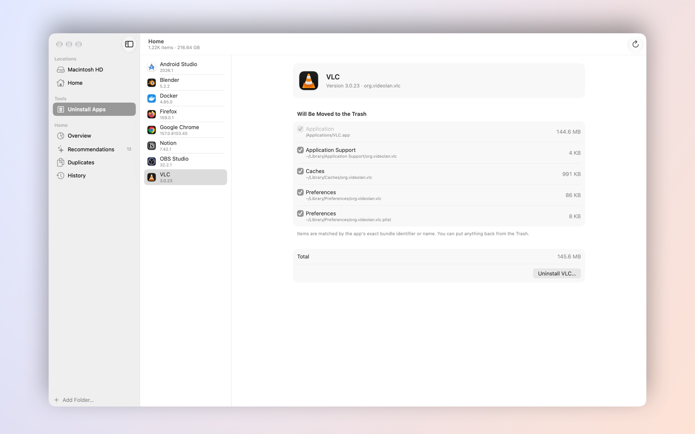
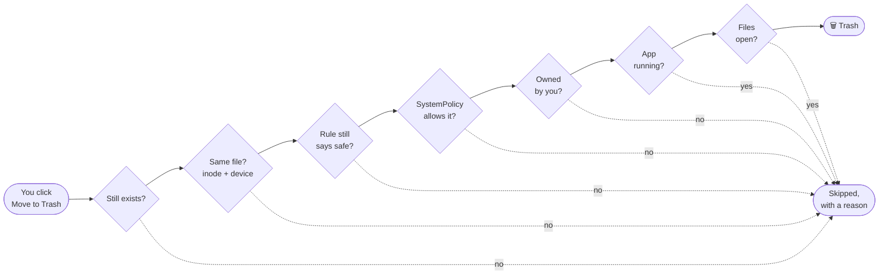

<div align="center">



# KlaD

### Kernel Block & Logical Allocation Debugger

**See where your Mac's storage actually went — measured the way APFS really allocates it.**<br>
Native. Fast. Free. And it never touches what it shouldn't.

<a href="https://github.com/kidraah/KlaD/releases/latest"></a>


<br><br>

<picture>
  <source media="(prefers-color-scheme: dark)" srcset="docs/media/live-dark.gif">
  
</picture>

<sub>Recorded live, real clicks and hovers, at 60 fps. The Mac in it is fictional. It follows your Light or Dark mode.</sub>

</div>

<br>

## Your Mac is lying to you about sizes

On APFS, files share blocks with clones and snapshots, sparse files claim space they never use, and
iCloud placeholders take up nothing at all. Finder adds up what files *say* they hold. KlaD asks the
kernel what they *cost*:

| | What it means | Where KlaD gets it |
|---|---|---|
| **Logical** | What the file says it holds. A sparse VM disk can claim 1 TB. | `ATTR_FILE_TOTALSIZE` |
| **Size on disk** | The blocks actually allocated. | `ATTR_FILE_ALLOCSIZE` |
| **Freed if deleted** | Blocks no clone, snapshot or hard link shares — what you'd really get back. | `ATTR_CMNEXT_PRIVATESIZE` |
| **In iCloud only** | Placeholders: 0 bytes on disk. Never opened, never downloaded. | `SF_DATALESS` |

> A `uv` cache that "is" **4.48 GB** frees only **2.87 GB** — uv clones its files. KlaD shows you both.

<br>

## Everything at a glance

<table>
  <tr>
    <td width="50%" valign="top">
      <picture>
        <source media="(prefers-color-scheme: dark)" srcset="docs/media/sunburst-focus-dark.jpg">
        
      </picture>
      <h3>Sunburst</h3>
      Click any ring to dive in and the center to come back. Colors are categories —
      AI models, Xcode, media, caches, build output — so the culprit jumps out.
    </td>
    <td width="50%" valign="top">
      <picture>
        <source media="(prefers-color-scheme: dark)" srcset="docs/media/treemap-dark.jpg">
        
      </picture>
      <h3>Heat-map treemap</h3>
      Sections with headers, solid tiles, bold labels and real Finder icons —
      read like a stock-market map: the biggest blocks are your biggest problems.
    </td>
  </tr>
  <tr>
    <td width="50%" valign="top">
      <picture>
        <source media="(prefers-color-scheme: dark)" srcset="docs/media/recommendations-dark.jpg">
        
      </picture>
      <h3>Recommendations</h3>
      <b>Safe to Clear</b> only when a rule proves it regenerates: <code>node_modules</code> next to a lockfile,
      Rust <code>target/</code>, <code>.venv</code>, DerivedData, package caches. Model weights and archives go to
      <b>Review First</b>. Docker, VMs and snapshots get guided commands, never silent deletes.
    </td>
    <td width="50%" valign="top">
      <picture>
        <source media="(prefers-color-scheme: dark)" srcset="docs/media/uninstaller-dark.jpg">
        
      </picture>
      <h3>Uninstall apps — completely</h3>
      Dragging an app to the Trash leaves its caches, settings and support files behind, so a reinstall
      comes back "dirty". KlaD removes the app <i>and</i> its leftovers, matched by exact bundle ID,
      and clears the cached preferences macOS keeps in memory.
    </td>
  </tr>
</table>

**Also inside:** a whole-disk view where macOS, Preboot, Recovery, VM and "System Data" are sized by APFS
itself (so the disk adds up without opening system data) · byte-identical **Duplicates** ≥ 1 MB ·
**History** of every scan with what changed · **Live updates** via FSEvents · instant switching between
locations · Light, Dark or Automatic.

<br>

## Three promises

> [!IMPORTANT]
> **1 · No Full Disk Access, ever.** KlaD works fully without it, and doesn't ask.
>
> **2 · Protected and system data is never touched.** Mail, Messages, Safari, browser profiles, other apps'
> containers, iOS backups, the Photos library, the sealed system volume — never opened, not even listed.
> Their space comes from APFS's own volume totals, the same numbers System Settings uses.
>
> **3 · Nothing is deleted without proof and your OK.** Everything goes to the Trash (Put Back works),
> only from inside your home folder (plus apps you installed), after re-checking it right before the move.

Every rule lives in one file — [`Sources/Models/SystemPolicy.swift`](Sources/Models/SystemPolicy.swift) — and
every cleanup passes seven checks first:



It also never opens, reads or hashes iCloud-only files: the kernel's I/O policy is set so even an accident
can't trigger a download.

<br>

## Fast, and quiet about it

| | |
|---|---|
| Scanner | `getattrlistbulk(2)` — one syscall returns a whole directory's attributes. ~350 000 items/s. |
| Home folder, 2.5 M items | ~8 s, at about 2.5 cores — your Mac stays usable while it runs |
| Whole disk | ~9 s |
| Switching locations | instant — recent results stay in memory |
| Idle | 0 % CPU. Live updates only run while KlaD is in front, at most every 20 s. |

<br>

## Install

1. Download **`KlaD-<version>.dmg`** from [Releases](https://github.com/kidraah/KlaD/releases/latest) and drag KlaD to Applications.
   It runs on Apple silicon and Intel, macOS 14 Sonoma or later.
2. KlaD isn't notarized by Apple yet, so the first launch needs one extra step: open it, then go to
   **System Settings › Privacy & Security** and click **Open Anyway**.

<details>
<summary><b>Build from source</b> — Command Line Tools are enough, no Xcode needed</summary>

```sh
make signing-identity   # once: a local signing identity, so macOS remembers folder permissions
make run                # release build → build/KlaD.app, then open it
make test               # 144 Swift Testing tests
make dmg                # universal build → build/KlaD-<version>.dmg
make media              # regenerate the screenshots in this README
make demo-video         # record the live demo (drives the mouse for ~40 s per theme)
make probe              # headless scanner: klad-probe scan ~ | verify <dir> | volume /
```

The README media come from `--demo`, a fictional Mac built in memory — nothing from your disk ends up in a screenshot.
The demo is a live recording: [`Scripts/record-demo.swift`](Scripts/record-demo.swift) drives the real mouse and captures
KlaD with ScreenCaptureKit, then [`Scripts/render-demo.swift`](Scripts/render-demo.swift) adds the backdrop, an eased
camera that follows the cursor, and click ripples.

</details>

<details>
<summary><b>How it's built</b></summary>

```
Sources/Models/      shared contracts · SystemPolicy (what may be read or modified)
Sources/Scanner/     getattrlistbulk engine · firmlink and mount guard · APFS volume accounting
Sources/Services/    Intelligence (rules, classification) · StorageOps (history, duplicates, safe cleanup, FSEvents)
Sources/App, UI/     native SwiftUI: NavigationSplitView, inspector, Canvas sunburst and treemap
Tests/KlaDTests/     Core · Intelligence · StorageOps
```

Swift 6 with strict concurrency, no dependencies beyond the macOS SDK and SQLite.

</details>

<br>

<div align="center">

**MIT licensed** · made for people whose "System Data" is somehow 200 GB

</div>
